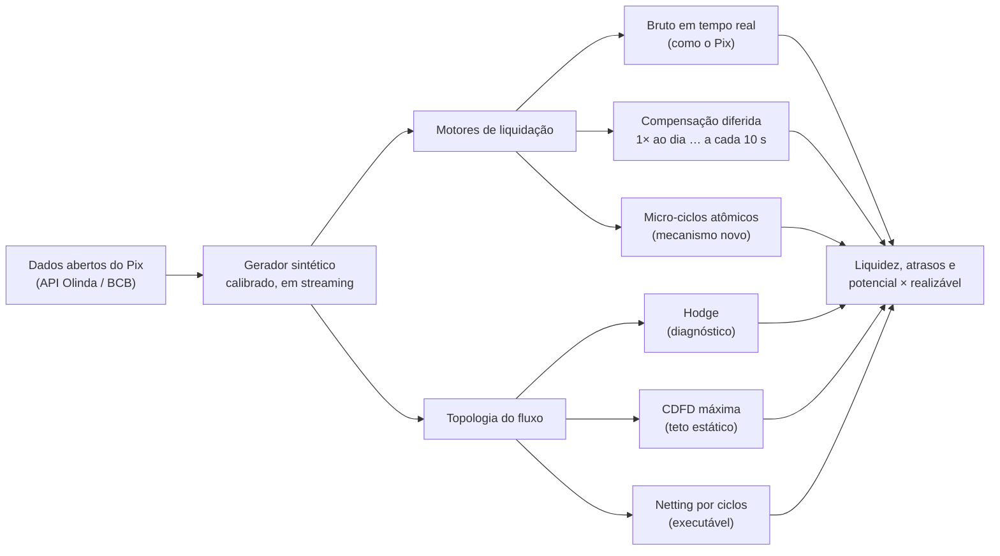

<p align="center">
  
</p>

<p align="center">
  <a href="LICENSE"></a>
  
  
  
  
</p>

<p align="center">
  <b>Simulador aberto que mede quanto da liquidez de um sistema de pagamentos instantâneos dá voltas entre as instituições — e quanto disso é recuperável na prática.</b><br>
  <i>An open simulator that measures how much of the liquidity in an instant payment system goes around in loops — and how much of it can actually be recovered.</i>
</p>

<p align="center">
  <a href="#português">Português</a> ·
  <a href="#english">English</a> ·
  <a href="results/SUMMARY.md">Resultados</a> ·
  <a href="docs/METHODOLOGY.md">Metodologia</a> ·
  <a href="docs/LIMITATIONS.md">Limitações</a>
</p>

---

## Português

### O problema

O Pix liquida cada pagamento de forma **bruta e em tempo real**: cada instituição precisa ter
saldo na sua Conta PI antes de cada transferência. Nos sistemas antigos, os bancos podiam
acumular pagamentos e compensar entradas com saídas (*netting*), economizando liquidez.
Estudos recentes mostram que o Pix tirou dos bancos boa parte dessa compensação.

Mas uma pergunta continuava sem resposta: **quanto dessa compensação perdida vira, de fato,
liquidez que poderia ser liberada?** E dá para recuperar parte dela sem abrir mão da
experiência instantânea do usuário?

O LoopSettle responde a essa pergunta com simulação calibrada e matemática de redes.

### O resultado principal

<p align="center">
  
</p>

No cenário sintético calibrado com dados públicos do Pix:

- **85% do volume** de pagamentos poderia ser "compensado" pela medida potencial usada na
  literatura (entradas e saídas do mesmo dia, sem olhar a ordem no tempo).
- Mas a **economia de liquidez realizável** depende do horizonte da compensação: **9,3%** com
  uma compensação diária, **0,3%** a cada 15 minutos e **menos de 0,03%** com ciclos de
  segundos.
- **Micro-ciclos atômicos de até 10 s liquidam até 63% do valor dentro de ciclos, mas
  economizam menos de 0,02% da liquidez.** A necessidade de liquidez é dirigida por
  desequilíbrios que duram horas, não por ruído de segundos.

> **Volume compensável não é liquidez economizada.** É a distância entre essas duas medidas
> que o LoopSettle torna visível e mensurável.

Todos os números em [`results/SUMMARY.md`](results/SUMMARY.md), com a semente, a versão do
código e o comando que os gerou. O que o estudo pode e não pode afirmar está em
[`docs/CLAIMS.md`](docs/CLAIMS.md).

### Como funciona



**Três lentes para medir o dinheiro que dá voltas**

| Lente | O que mede | Por que importa |
|---|---|---|
| **Decomposição de Hodge** | separa o fluxo em componente direcional e circular | ótimo diagnóstico, mas pode atribuir ao ciclo mais do que existe de fato |
| **CDFD máxima** | maior circulação possível respeitando o valor de cada pagamento | teto realista e exato do que poderia ser compensado (calculado por fluxo de custo mínimo, conferido contra um solver de programação linear em 1.000 grafos) |
| **Netting por ciclos** | o que um algoritmo de compensação consegue cancelar | o que é executável na prática |

**Três desenhos de liquidação, lado a lado**

| Motor | Comportamento |
|---|---|
| `GrossRealTime` | liquida cada pagamento na chegada, se houver saldo (o modelo do Pix) |
| `DeferredNet` | compensação multilateral em ciclos fixos, de 1 por dia a 1 a cada 10 s (estilo UPI) |
| `AtomicMicroCycle` | espera alguns segundos, encontra ciclos na fila e liquida cada ciclo de uma vez — tudo ou nada |

### Resultados em números

| Medida | Valor |
|---|---|
| Erro da calibração frente aos agregados públicos do Pix | ≤ 1,5% em todos os agregados |
| Liquidez do bruto em tempo real (UB) / volume bruto | 16,1% |
| Liquidez com uma compensação diária (LB) / UB | 0,91 |
| Escada de circularidade (grafo bruto): Hodge → CDFD → ciclos | 1,18 → 0,83 → 0,80 |
| Instantâneo vs 1 ciclo por dia (lógica do estudo finlandês) | 1,10× a 1,50× a liquidez |
| Micro-ciclos com espera de 2 s: meta do Pix de 50% em até 2,8 s | cumprida (100%) |
| Micro-ciclos com espera de 10 s: mesma meta | não cumprida (43%) |

<table>
  <tr>
    <td width="50%"></td>
    <td width="50%"></td>
  </tr>
  <tr>
    <td align="center"><sub>Micro-ciclos: economia × atraso</sub></td>
    <td align="center"><sub>Instantâneo × ciclos de compensação por dia</sub></td>
  </tr>
</table>

### Interface interativa

O simulador também roda inteiro no navegador, compilado para WebAssembly, sem servidor. A
interface mostra a rede de participantes com o componente circular destacado, controles de
janela e espera dos micro-ciclos, gráficos de liquidez e atrasos e o painel "potencial ×
realizável". Funciona em computadores modestos e em celulares, em modo reduzido.

<!-- Captura da interface: salve em docs/img/interface.png e remova este comentário.
<p align="center"></p>
-->

```bash
cd web && npm install && npm run wasm && npm run dev
```

### Comece em 3 comandos

```bash
cargo test --workspace                                                       # invariantes e testes
cargo run --release -p loopsettle-cli -- experiment potential-vs-realizable  # comparação central
cd web && npm install && npm run wasm && npm run dev                         # interface
```

Tudo de uma vez, do zero: `make rebuild`. Roda num Intel i3 de 4ª geração com 4 GB de RAM:
cada experimento usa menos de 20 MiB e termina em segundos.

### Reprodutibilidade

Cada número publicado vem de um comando, com semente fixa. Rodar de novo reproduz os
resultados **byte a byte**.

| Experimento | Pergunta | Saída |
|---|---|---|
| `calibration` | o gerador reproduz os agregados públicos do Pix? | `results/calibration/` |
| `baseline` | quanto é circular, pelas três lentes? | `results/baseline/` |
| `potential-vs-realizable` | quanto da compensação potencial vira liquidez? | `results/potential-vs-realizable/` |
| `microcycle-sweep` | qual a troca entre atraso e liquidez? | `results/microcycle-sweep/` |
| `stress` | o que acontece se um participante grande cair? | `results/stress/` |
| `finland-replication` | a lógica do Banco da Finlândia aplicada ao cenário | `results/finland-replication/` |

**Garantias testadas por propriedades** (milhares de casos aleatórios a cada execução):
conservação do dinheiro, preservação da posição líquida de cada participante, ausência de
saldo negativo, atomicidade dos micro-ciclos, netting que nunca inverte a direção de um
pagamento, consistência da decomposição de Hodge e determinismo total.

### Arquitetura

| Componente | Conteúdo |
|---|---|
| [`loopsettle-core`](crates/loopsettle-core) | ledger em centavos, motores de liquidação, métricas em streaming |
| [`loopsettle-topology`](crates/loopsettle-topology) | Hodge (gradiente conjugado implementado à mão), CDFD exata, netting por ciclos |
| [`loopsettle-sim`](crates/loopsettle-sim) | gerador sintético calibrado, em streaming |
| [`loopsettle-cli`](crates/loopsettle-cli) | experimentos reprodutíveis, saída em CSV, JSON e SVG |
| [`loopsettle-wasm`](crates/loopsettle-wasm) + [`web/`](web) | interface Vite + React + Canvas 2D, simulação num Web Worker |
| [`data/`](data) | download dos agregados públicos do Pix |
| [`docs/`](docs) | metodologia, parâmetros, limitações, afirmações, novidade |

Núcleo sem dependências externas: álgebra linear, gerador aleatório e formatos de arquivo
foram implementados no próprio projeto.

### Limitações

O LoopSettle é honesto sobre o que não sabe. As principais limitações:

- **Dados sintéticos calibrados, não dados interbancários reais.** Só agregados públicos são
  usados; quem paga a quem não é público e é a principal hipótese do modelo.
- **Escala reduzida:** 200 participantes e 1 milhão de pagamentos por dia, enquanto o Pix
  real tem cerca de 239 milhões.
- **Micro-ciclos heurísticos:** a busca de ciclos é simples, não um otimizador completo.

Lista completa em [`docs/LIMITATIONS.md`](docs/LIMITATIONS.md); hipóteses e fonte de cada
parâmetro em [`docs/PARAMETERS.md`](docs/PARAMETERS.md).

### Trabalhos em que se apoia

- Hellqvist, M. & Korpinen, K. *Instant payments as the new normal*. Banco da Finlândia
  (2021); *Journal of Financial Market Infrastructures* (2026). **Base metodológica que este
  projeto estende.**
- Banco Central do Brasil, Working Paper 619 — instant payments, perda de netting e liquidez
  bancária.
- Homs-Dones, M., MacKay, R. S., Sansom, B. & Zhou, Y. *How circular is a directed network?
  A flow decomposition approach*. *Royal Society Open Science* (2026); arXiv 2506.12546.
- Bech, M. & Soramäki, K. *Gridlock Resolution in Interbank Payment Systems*. Banco da
  Finlândia, DP 9/2001.
- PixSim, arXiv 2609.30684 — calibração com fonte para cada parâmetro.

### Como citar

```bibtex
@software{dorneles_loopsettle,
  author  = {Dorneles, Fabio D.},
  title   = {LoopSettle: an open simulator of circular liquidity in instant payment systems},
  version = {0.1.0},
  url     = {https://github.com/fabiodrneles/loopsettle},
  license = {Apache-2.0}
}
```

Os metadados também estão em [`CITATION.cff`](CITATION.cff) (o GitHub mostra o botão
"Cite this repository").

### Licença

[Apache-2.0](LICENSE).

---

## English

### The problem

Brazil's Pix settles every payment **gross and in real time**: each institution must hold
funds in its settlement account before every transfer. Older systems let banks batch payments
and offset inflows against outflows (*netting*), saving liquidity. Recent research shows that
Pix removed much of that netting. What remained open is **how much of the lost netting
translates into liquidity that could actually be freed**, and whether part of it can be
recovered without giving up the instant user experience.

### Key finding

In a synthetic scenario calibrated to public Pix aggregates:

- **85% of payment volume** is nettable under the potential measure used in the literature
  (same-day inflows vs outflows, ignoring time order).
- The **realizable liquidity saving** depends on the netting horizon: **9.3%** with one
  daily netting cycle, **0.3%** every 15 minutes, and **under 0.03%** with second-scale
  cycles.
- **Atomic micro-cycles of up to 10 s settle up to 63% of value inside cycles, yet save
  under 0.02% of liquidity.** Liquidity needs are driven by imbalances lasting hours, not by
  second-scale noise.

> **Nettable volume is not saved liquidity.** LoopSettle makes the gap between the two
> visible and measurable.

### What it does

- **Three lenses on circular flow:** Hodge decomposition (diagnostic), maximum CDFD
  circulation (exact static ceiling, via min-cost flow, checked against an LP solver on 1,000
  graphs) and cycle netting (executable).
- **Three settlement designs side by side:** real-time gross (Pix), deferred net cycles (1/day
  down to every 10 s) and a new **atomic micro-cycle** engine.
- **Calibrated synthetic flows** from Banco Central do Brasil open data, streamed so that
  each run fits in a few MiB.
- **Runs in the browser** through WebAssembly, with an interactive network view.

### Quick start

```bash
cargo test --workspace
cargo run --release -p loopsettle-cli -- experiment potential-vs-realizable
cd web && npm install && npm run wasm && npm run dev
```

Everything from scratch: `make rebuild`. Every published number is produced by a command with a
fixed seed and reproduces byte for byte. Code is in English; detailed documentation is in
Portuguese.

### Limitations

Synthetic data calibrated to public aggregates — **not real interbank data**; the bilateral
structure (who pays whom) is the main assumption; reduced scale; heuristic micro-cycle search.
See [`docs/LIMITATIONS.md`](docs/LIMITATIONS.md) and [`docs/CLAIMS.md`](docs/CLAIMS.md).

### Cite

See [`CITATION.cff`](CITATION.cff) or the BibTeX entry above.

### License

[Apache-2.0](LICENSE).
