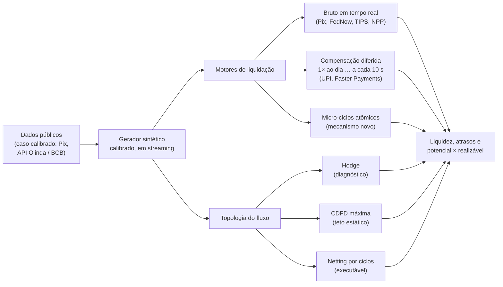
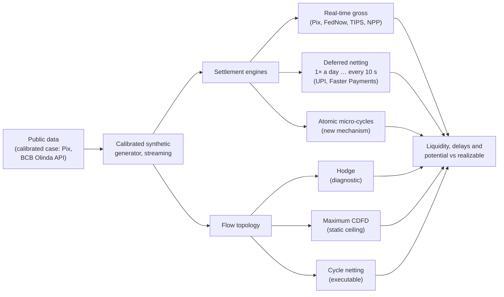

<p align="center">
  
</p>

<p align="center">
  <a href="LICENSE"></a>
  
  
  
  
  
  
</p>

<p align="center">
  <b>Simulador aberto que mede quanto da liquidez de um sistema de pagamentos instantâneos dá voltas entre as instituições — e quanto disso é recuperável na prática.</b><br>
  <i>An open simulator that measures how much of the liquidity in an instant payment system goes around in loops — and how much of it can actually be recovered.</i>
</p>

<p align="center">
  <b><a href="#português">Português</a></b> ·
  <a href="results/SUMMARY.pt-BR.md">Resultados</a> ·
  <a href="docs/METHODOLOGY.pt-BR.md">Metodologia</a> ·
  <a href="docs/LIMITATIONS.pt-BR.md">Limitações</a> ·
  <a href="docs/REFERENCES.pt-BR.md">Referências</a>
  <br>
  <b><a href="#english">English</a></b> ·
  <a href="results/SUMMARY.md">Results</a> ·
  <a href="docs/METHODOLOGY.md">Methodology</a> ·
  <a href="docs/LIMITATIONS.md">Limitations</a> ·
  <a href="docs/REFERENCES.md">References</a>
</p>

---

## Português

<p align="center">
  
</p>
<p align="center"><sub>A interface roda inteira no navegador (Rust → WebAssembly, num Web Worker): 40 participantes e 100 mil pagamentos simulados em 0,5 s. Botão no canto para trocar para inglês.</sub></p>

### Em uma frase

Nos sistemas de pagamentos instantâneos com liquidação bruta — Pix (Brasil), FedNow (EUA), TIPS
(zona do euro), NPP (Austrália) — cada banco precisa ter dinheiro em caixa antes de cada
transferência. Parte desse dinheiro só "dá voltas" (A paga B, B paga C, C paga A). O LoopSettle
mede quanto é essa parte,
quanto dela daria para compensar e, principalmente, **quanto dessa compensação vira liquidez
economizada de verdade** quando se respeita a ordem em que os pagamentos acontecem.

### O problema

Cada vez mais países adotam pagamentos instantâneos liquidados de forma **bruta e em tempo
real**: cada pagamento é liquidado sozinho, na hora, e o banco pagador precisa ter saldo no banco
central antes de cada transferência. Nos sistemas antigos, os bancos podiam acumular pagamentos e
compensar entradas com saídas (*netting*), economizando liquidez. No Brasil, onde o Pix funciona
assim desde 2020, o estudo do Banco Central (Working Paper 619) mostra que os bancos perderam essa
capacidade de adiar e compensar, e passaram a reter mais ativos líquidos. O Banco da Finlândia
fez a mesma pergunta para a Europa.

O LoopSettle usa o **Pix como caso calibrado**, porque ele publica os agregados necessários, mas
os motores e as métricas valem para qualquer sistema do mesmo tipo. Veja
[onde o seu sistema se encaixa](#onde-o-seu-sistema-se-encaixa).

Uma pergunta continuava sem resposta: **quanto dessa compensação perdida vira, de fato,
liquidez que poderia ser liberada?** E dá para recuperar parte dela sem abrir mão da
experiência instantânea do usuário?

> **Pergunta de pesquisa.** Num sistema de pagamentos instantâneos com liquidação bruta — com o
> Pix como caso calibrado —, quanto da liquidez que os participantes precisam manter é circular,
> quanto disso é recuperável na prática, e qual o custo em atraso de recuperá-la com micro-ciclos
> atômicos?

### O resultado principal

<p align="center">
  
</p>

No cenário sintético calibrado com dados públicos do Pix (200 participantes; 10 sementes; de 1 a
30 milhões de pagamentos por dia):

- **85% do volume** de pagamentos poderia ser "compensado" pela medida potencial (entradas e
  saídas do mesmo dia, sem olhar a ordem no tempo).
- **Micro-ciclos atômicos de até 10 s liquidam até 63% do valor dentro de ciclos, mas
  economizam cerca de 0,01% da liquidez** (0,0116%, IC 95% [0,008; 0,015]%), qualquer que seja
  o tamanho máximo do ciclo, e a economia vai a zero quando o volume cresce.
- **Há um teto demonstrável:** nenhum mecanismo que segure cada pagamento por no máximo *d*
  consegue economizar mais do que o valor pago nos *d* segundos antes do pico de cada
  participante. Para 10 s, esse teto fica abaixo de 1% em todas as configurações testadas.
- Compensar em horizontes maiores economiza mais (0,5% a cada 15 minutos; 7,8% uma vez por dia,
  com 1 milhão de pagamentos), **mas esse "potencial" encolhe com a raiz quadrada do volume**
  (1,7% com 30 milhões). Quanto dele existe no Pix real depende de desequilíbrios intradiários
  que os dados públicos não mostram — é a principal pergunta aberta
  ([avaliação](docs/ASSESSMENT.pt-BR.md)).

> **Volume compensável não é liquidez economizada.** O LoopSettle torna visível e mensurável a
> distância entre essas duas medidas.

Todos os números estão em [`results/SUMMARY.pt-BR.md`](results/SUMMARY.pt-BR.md), com a semente, a versão
do código e o comando que os gerou. O que o estudo pode e não pode afirmar está em
[`docs/CLAIMS.pt-BR.md`](docs/CLAIMS.pt-BR.md).

*(As figuras geradas pelos experimentos têm rótulos em inglês, a língua do código; as legendas
e o [`results/SUMMARY.pt-BR.md`](results/SUMMARY.pt-BR.md) explicam cada uma em português.)*

### A interface

<table>
  <tr>
    <td width="58%"></td>
    <td width="42%"></td>
  </tr>
  <tr>
    <td align="center"><sub><b>A rede de um dia.</b> Tamanho do círculo = atividade; tracejado = pagador líquido. Em verde, a maior circulação possível (CDFD); em cinza, o fluxo que só vai numa direção.</sub></td>
    <td align="center"><sub><b>Potencial × realizável.</b> A escada das medidas, da compensação no papel até a liquidez poupada de fato.</sub></td>
  </tr>
  <tr>
    <td></td>
    <td></td>
  </tr>
  <tr>
    <td align="center"><sub><b>O dia em 15 minutos.</b> A soma das posições devedoras (linha escura) cresce por horas: é isso que exige liquidez, e micro-ciclos de segundos não alcançam.</sub></td>
    <td align="center"><sub><b>Liquidez necessária por desenho</b>, do bruto em tempo real ao mínimo teórico (LB).</sub></td>
  </tr>
  <tr>
    <td></td>
    <td></td>
  </tr>
  <tr>
    <td align="center"><sub><b>Economia × janela.</b> A economia dos micro-ciclos para cada janela de busca de ciclos: sempre perto de zero.</sub></td>
    <td align="center"><sub><b>Liquidez restrita.</b> Com saldo inicial menor que o necessário: valor rejeitado e cumprimento da meta de 2,8 s.</sub></td>
  </tr>
</table>

<table>
  <tr>
    <td width="34%"></td>
    <td>

**O que dá para fazer na tela**

- Mexer na **janela de busca de ciclos** (0,5 a 10 s) e no **atraso máximo tolerado** (2 a 10 s)
  e ver a economia de liquidez e os atrasos se recalcularem.
- Mudar o número de participantes, de pagamentos e o **desequilíbrio entre recebedores** (a
  principal hipótese do modelo) para testar a robustez do resultado.
- Testar **liquidez restrita**: com saldo inicial menor que o necessário, quanto valor é
  rejeitado em cada desenho e quantos pagamentos cumprem a meta do Pix (50% em até 2,8 s).
- Trocar a **semente**: a mesma semente sempre produz o mesmo resultado.
- Trocar o **idioma** (português/inglês) no botão do canto, ou abrir com `?lang=pt` ou
  `?lang=en`.

**No celular** a interface entra em modo reduzido (até 25 participantes e 30 mil pagamentos)
com o mesmo modelo.

Os cenários do navegador são menores que os dos experimentos (até 50 participantes e 100 mil
pagamentos), então os números da tela não são os do artigo. Em cenários pequenos a economia dos
micro-ciclos pode até sair levemente **negativa** (−0,001%): a fila muda a ordem das
liquidações e o pico de um participante pode subir um pouco. É um resultado do modelo, coerente
com o achado principal (economia próxima de zero), e não um erro.

</td>
  </tr>
</table>

```bash
cd web && npm install && npm run wasm && npm run dev    # abre em http://localhost:5173
```

As capturas, nos dois idiomas, são regeneradas por comando: `node scripts/screenshots.cjs`
(com a interface no ar).

### Como funciona



**Três lentes para medir o dinheiro que dá voltas**

| Lente | O que mede | Por que importa |
|---|---|---|
| **Decomposição de Hodge** | separa o fluxo em componente direcional (gradiente) e circular | ótimo diagnóstico, mas pode atribuir ao ciclo mais do que existe: no triângulo A→B 10, B→C 5, C→A 5, Hodge dá 6,67 ao ciclo, e só 5 são compensáveis |
| **CDFD máxima** | maior circulação possível respeitando o valor de cada aresta e a conservação em cada nó | teto realista e exato do que poderia ser compensado (fluxo de custo mínimo implementado à mão, conferido contra um solver de programação linear em 1.000 grafos aleatórios) |
| **Netting por ciclos** | o que um algoritmo de compensação estilo Bech–Soramäki consegue cancelar | o que é executável na prática |

**Três desenhos de liquidação, lado a lado**

| Motor | Comportamento |
|---|---|
| `GrossRealTime` | liquida cada pagamento na chegada, se houver saldo (o modelo do Pix, FedNow, TIPS e NPP) |
| `DeferredNet` | compensação multilateral em ciclos fixos, de 1 por dia a 1 a cada 10 s (o modelo do UPI e do Faster Payments; lógica do estudo finlandês) |
| `AtomicMicroCycle` | espera alguns segundos, encontra ciclos na fila e liquida cada ciclo de uma vez, tudo ou nada; modos `QueueAll` (todos passam pela fila) e `QueueOnShortfall` (só na falta de saldo, estilo LSM) |

**Como a liquidez é medida**

- **UB (limite superior):** menor saldo inicial que evita qualquer rejeição no bruto em tempo
  real = máximo, ao longo do dia, de saídas acumuladas − entradas acumuladas.
- **LB (limite inferior):** posição líquida multilateral do fim do dia, o que uma única
  compensação diária exigiria.
- **Economia de um desenho** = 1 − liquidez do desenho ÷ UB.

Definições formais, exemplo à mão e provas em [`docs/METHODOLOGY.pt-BR.md`](docs/METHODOLOGY.pt-BR.md).

### Onde o seu sistema se encaixa

O Pix é o caso calibrado, mas a pergunta vale para qualquer país. Para o cliente, todos os
sistemas abaixo são instantâneos; o que muda a liquidez é **como os bancos acertam as contas
entre si**, e o LoopSettle tem um motor para cada modelo:

<table>
  <tr>
    <td width="40%"></td>
    <td>

| Modelo entre bancos | Exemplos | Motor |
|---|---|---|
| Bruto em tempo real | Pix (Brasil), FedNow (EUA), TIPS (zona do euro), NPP (Austrália) | `GrossRealTime` |
| Bruto, conta pré-financiada | RTP (EUA), Real-Time Rail (Canadá, em lançamento) | `GrossRealTime` com saldo limitado |
| Compensação diferida em ciclos | UPI (Índia, 10/dia), Faster Payments (Reino Unido, 3/dia), FAST (Singapura, 2/dia), Interac e-Transfer (Canadá, 1/dia) | `DeferredNet` |
| Compensação a cada poucos segundos | SPEI (México, em média a cada 1,9 s) | `AtomicMicroCycle` |

</td>
  </tr>
</table>

- **Nos EUA**, o FedNow funciona como o Pix: o resultado central se aplica diretamente ao desenho.
- **No Canadá**, o Interac e-Transfer é instantâneo para o cliente, mas os bancos compensam o saldo
  líquido uma vez por dia, pelo Lynx (modelo `DeferredNet`). O novo Real-Time Rail, com lançamento
  previsto para o fim de 2026, liquida em tempo real contra contas pré-financiadas no Bank of
  Canada: é exatamente o tipo de sistema para o qual a lógica do estudo finlandês mede o custo da
  migração.
- **No México**, o SPEI já roda um algoritmo de compensação a cada 1,9 s em média: é o análogo real
  mais próximo dos micro-ciclos atômicos.
- **Os números** (0,01%, 0,5%, 7,8%) vêm do cenário calibrado com o Pix e não valem
  automaticamente para outro país: recalibrar exige os agregados públicos dele.

Tabela completa, com operador, data de início, modelo de liquidação e fonte de cada sistema, em
[`docs/INSTANT_PAYMENTS.pt-BR.md`](docs/INSTANT_PAYMENTS.pt-BR.md).

### Resultados em números

| Medida | Valor |
|---|---|
| Erro da calibração frente aos agregados públicos do Pix | ≤ 1,5% em todos os 9 agregados |
| Liquidez do bruto em tempo real (UB) / volume bruto | 16,1% |
| Liquidez com uma compensação diária (LB) / UB | 0,91 |
| Escada de circularidade (grafo bruto): Hodge L1 → CDFD → ciclos | 1,18 → 0,83 → 0,80 |
| Escada de circularidade (grafo líquido): Hodge L2 → CDFD → ciclos | 0,98 → 0,17 → 0,14 |
| Instantâneo vs 1 ciclo por dia (lógica do estudo finlandês) | 1,10× (σ = 0,4) a 1,50× (σ = 0) a liquidez |
| Instantâneo vs 6 ciclos por dia (a base do STEP2) | 1,04× a 1,14× |
| Micro-ciclos com espera de 2 s: meta do Pix de 50% em até 2,8 s | cumprida (100%) |
| Micro-ciclos com espera de 10 s: mesma meta | não cumprida (43%) |
| Economia dos micro-ciclos de até 10 s † | 0,0116% do UB, IC 95% [0,008; 0,015]% |
| Teto para qualquer mecanismo de até 10 s † | 0,80% do UB (0,27% com 30 milhões de pagamentos) |
| Economia de uma compensação diária † | 7,8%, IC 95% [4,5; 11,1]% (1,7% com 30 milhões) |

<sub>Linhas sem marca: semente `20260930`, 1 milhão de pagamentos por dia. † 10 sementes, σ = 0,4 (`results/robustness/`).</sub>

<table>
  <tr>
    <td width="50%"></td>
    <td width="50%"></td>
  </tr>
  <tr>
    <td align="center"><sub>Micro-ciclos: economia × atraso</sub></td>
    <td align="center"><sub>Instantâneo × ciclos de compensação por dia</sub></td>
  </tr>
</table>

<p align="center">
  
</p>
<p align="center"><sub>A escada de circularidade: o diagnóstico (Hodge) atribui ao ciclo muito mais do que o teto exato (CDFD) e do que um algoritmo de compensação consegue cancelar.</sub></p>

### Diálogo com a literatura

#### Banco da Finlândia: o ponto de partida

Hellqvist e Korpinen (Banco da Finlândia, 2021; *JFMI*, 2026) perguntaram **quanto dinheiro a
mais os bancos precisam** quando um sistema de compensação em ciclos vira instantâneo. Eles
geraram transações sintéticas que imitam as transferências de varejo entre os participantes
finlandeses do STEP2 e compararam a liquidez do modelo em ciclos com a do modo instantâneo. O
LoopSettle parte exatamente dessa lógica e a estende.

| | Banco da Finlândia (Hellqvist & Korpinen) | LoopSettle |
|---|---|---|
| **Pergunta** | Quanto a mais de liquidez o instantâneo exige em relação aos ciclos? | A mesma, e o caminho inverso: quanto dá para **recuperar** sem perder o instantâneo, e a que custo em atraso? |
| **Sistema** | STEP2, varejo, Finlândia | Pagamentos instantâneos com liquidação bruta; caso calibrado: Pix, Brasil (24×7, banco central) |
| **Dados** | Sintéticos, imitando os fluxos do STEP2 | Sintéticos, calibrados com agregados públicos do Pix (erro ≤ 1,5%); cada parâmetro com fonte ou marcado `ASSUMPTION` |
| **Desenhos comparados** | Ciclos fixos × instantâneo | Ciclos fixos (1 a 8.640 por dia) × instantâneo × **micro-ciclos atômicos** (novo) |
| **Definição de liquidez** | Menor saldo sem rejeição: posição mínima do dia (instantâneo) e mínima das posições de fim de ciclo (ciclos) | A mesma (UB e LB), confirmada no texto deles |
| **Resultado agregado** | Contra os 6 ciclos diários do STEP2: +2,7% em média e menos de 8,6% em 95% dos dias. Contra 1 ciclo diário: 1,45× a liquidez[^bof] | Contra 6 ciclos: +3,9% (σ = 0,4) a +13,7% (σ = 0). Contra 1 ciclo: 1,10× a 1,50×: **mesma ordem de grandeza** |
| **Heterogeneidade** | Diferenças grandes entre bancos e entre dias; recomenda reservas de liquidez | Medida por participante (`results/baseline/participants.csv`); a sensibilidade ao desequilíbrio entre recebedores muda a razão de 1,10× para 1,50× |
| **Circularidade** | Não mede | Três lentes (Hodge, CDFD, ciclos) e a escada entre elas |
| **Potencial × realizável** | Não separa | Separa: é o resultado central |
| **Código** | Não localizado publicamente (a conferir) | Aberto (Apache-2.0), reprodutível byte a byte, roda num i3 com 4 GB e no navegador |

**Onde os dois estudos concordam:** a migração para o instantâneo custa poucos pontos
percentuais de liquidez agregada quando o sistema anterior já tinha vários ciclos por dia.
**O que o LoopSettle acrescenta:** a liquidez perdida está quase toda em horizontes de horas.
Por isso ela não volta com compensação em segundos, por mais valor que os micro-ciclos consigam
liquidar dentro de ciclos.

> Isto **não é uma replicação** do estudo finlandês: aplicamos a mesma lógica a outro cenário e
> comparamos ordens de grandeza (ver [`docs/CLAIMS.pt-BR.md`](docs/CLAIMS.pt-BR.md), item "não pode" 5).

[^bof]: Hellqvist & Korpinen (2021), p. 2 e 9–11: 1.000 dias sintéticos para o aumento médio e o
    percentil 95; 30 dias para a comparação com 1 ciclo (€ 231 mi contra € 335 mi). Ver
    [`docs/REFERENCES.pt-BR.md`](docs/REFERENCES.pt-BR.md).

#### Os outros trabalhos

| Trabalho | O que fez | O que o LoopSettle faz com ele |
|---|---|---|
| Gonzalez, Ma & Zeng, **BCB WP 619** (2025) | Com dados reais do Pix, mostra que os bancos perderam a capacidade de adiar e compensar pagamentos e passaram a reter mais ativos líquidos | Reproduz a medida **potencial** de compensação (sem ordem no tempo) em dados sintéticos e a coloca ao lado da economia **realizável** no tempo |
| Homs-Dones, MacKay, Sansom & Zhou, **CDFD** (arXiv 2506.12546, 2025) | Decompõe o fluxo de uma rede em parte circular e parte direcional respeitando conservação e o limite de cada aresta | Implementa a decomposição de **circularidade máxima** de forma exata (fluxo de custo mínimo) e a usa como teto estático; a variante proporcional (BFF) fica para depois |
| Bech & Soramäki, **BoF DP 9/2001** | Algoritmos de resolução de *gridlock* por ciclos em sistemas interbancários | Netting por ciclos e a base dos micro-ciclos atômicos, agora com atraso máximo e a meta de tempo do Pix |

Comparação completa, ponto a ponto, em [`docs/NOVELTY.pt-BR.md`](docs/NOVELTY.pt-BR.md).

### Comece em 3 comandos

```bash
cargo test --workspace                                                       # invariantes e testes
cargo run --release -p loopsettle-cli -- experiment potential-vs-realizable  # comparação central
cd web && npm install && npm run wasm && npm run dev                         # interface
```

Requisitos: Rust estável com o target `wasm32-unknown-unknown`, `wasm-pack` e Node LTS.
Tudo de uma vez, do zero: `make rebuild`. Roda num Intel i3 de 4ª geração com 4 GB de RAM:
cada experimento usa menos de 20 MiB e termina em segundos.

### Reprodutibilidade

Cada número publicado vem de um comando com semente fixa. Rodar de novo reproduz os resultados
**byte a byte**; a semente e a versão do código ficam registradas em cada `summary.json`.

| Experimento | Pergunta | Saída |
|---|---|---|
| `calibration` | o gerador reproduz os agregados públicos do Pix? | `results/calibration/` |
| `baseline` | quanto é circular, pelas três lentes? | `results/baseline/` |
| `potential-vs-realizable` | quanto da compensação potencial vira liquidez? | `results/potential-vs-realizable/` |
| `microcycle-sweep` | qual a troca entre atraso e liquidez? | `results/microcycle-sweep/` |
| `stress` | o que acontece se um participante grande cair por 30 min? | `results/stress/` |
| `finland-replication` | a lógica do Banco da Finlândia aplicada ao cenário | `results/finland-replication/` |
| `robustness` | o resultado sobrevive a sementes, escala, viés e algoritmo? | `results/robustness/` |

**Oito invariantes testadas por propriedades** (`proptest`, milhares de casos aleatórios a cada
execução): conservação do dinheiro; preservação da posição líquida de cada participante;
ausência de saldo negativo; atomicidade dos micro-ciclos; netting que nunca inverte a direção
de um pagamento nem cancela mais que o menor pagamento do ciclo; consistência da decomposição de
Hodge; determinismo total; e o caso fixo do triângulo.

### Arquitetura

| Componente | Conteúdo |
|---|---|
| [`loopsettle-core`](crates/loopsettle-core) | ledger em centavos (`i64`, nunca ponto flutuante), motores de liquidação, métricas em streaming |
| [`loopsettle-topology`](crates/loopsettle-topology) | Hodge (gradiente conjugado implementado à mão), CDFD exata, netting por ciclos |
| [`loopsettle-sim`](crates/loopsettle-sim) | gerador sintético calibrado, em streaming |
| [`loopsettle-cli`](crates/loopsettle-cli) | experimentos reprodutíveis, saída em CSV, JSON e SVG |
| [`loopsettle-wasm`](crates/loopsettle-wasm) + [`web/`](web) | interface Vite + React + Canvas 2D, simulação num Web Worker, português e inglês |
| [`data/`](data) | download dos agregados públicos do Pix (API Olinda do BCB) |
| [`docs/`](docs) | metodologia, parâmetros, limitações, afirmações, novidade, referências (arquivos `*.pt-BR.md`) |

O núcleo não tem dependências externas: álgebra linear esparsa, gerador aleatório e formatos de
arquivo foram implementados no próprio projeto.

### Documentação

| Documento | Conteúdo |
|---|---|
| [`docs/INSTANT_PAYMENTS.pt-BR.md`](docs/INSTANT_PAYMENTS.pt-BR.md) | pagamentos instantâneos pelo mundo: modelo de liquidação de cada sistema e motor correspondente |
| [`docs/ASSESSMENT.pt-BR.md`](docs/ASSESSMENT.pt-BR.md) | avaliação crítica: o resultado se sustenta? ameaças, veredito e critérios de morte |
| [`docs/PAPER_READINESS.pt-BR.md`](docs/PAPER_READINESS.pt-BR.md) | especificação de tudo o que falta antes de escrever o artigo |
| [`docs/METHODOLOGY.pt-BR.md`](docs/METHODOLOGY.pt-BR.md) | cada métrica em linguagem simples e formal, com exemplo à mão |
| [`docs/PARAMETERS.pt-BR.md`](docs/PARAMETERS.pt-BR.md) | cada parâmetro do gerador: `SOURCED`, `CALIBRATED` ou `ASSUMPTION`; tabela real × simulado |
| [`docs/LIMITATIONS.pt-BR.md`](docs/LIMITATIONS.pt-BR.md) | limitações conhecidas |
| [`docs/CLAIMS.pt-BR.md`](docs/CLAIMS.pt-BR.md) | o que o estudo pode e não pode afirmar, com a evidência |
| [`docs/NOVELTY.pt-BR.md`](docs/NOVELTY.pt-BR.md) | comparação ponto a ponto com os trabalhos de referência |
| [`docs/REFERENCES.pt-BR.md`](docs/REFERENCES.pt-BR.md) | referências e situação de verificação de cada uma |
| [`docs/PAPER_OUTLINE.pt-BR.md`](docs/PAPER_OUTLINE.pt-BR.md) | esqueleto do artigo, com figuras e tabelas |
| [`DECISIONS.pt-BR.md`](DECISIONS.pt-BR.md) | decisões de desenho: alternativas, motivo e como reverter |
| [`REVIEW.pt-BR.md`](REVIEW.pt-BR.md) | pontos abertos para a revisão antes do artigo |
| [`results/SUMMARY.pt-BR.md`](results/SUMMARY.pt-BR.md) | todos os números, gerados por comando |
| [`data/README.md`](data/README.md) | dados públicos e como baixá-los |

Todos os documentos existem nos dois idiomas: o nome sem sufixo é a versão em inglês e `*.pt-BR.md` é a versão em português (link no topo de cada arquivo).

### Limitações

O LoopSettle é explícito sobre o que não sabe:

- **Dados sintéticos calibrados, não dados interbancários reais.** Só agregados públicos são
  usados. Quem paga a quem não é público e é a principal hipótese do modelo; por isso há uma
  análise de sensibilidade ao desequilíbrio entre recebedores (σ de 0 a 0,8).
- **Escala reduzida:** 200 participantes e 1 milhão de pagamentos por dia, contra cerca de 239
  milhões no Pix real. As frações são o resultado; os valores absolutos não escalam linearmente.
- **Micro-ciclos heurísticos:** a busca de ciclos é simples, não um otimizador completo.
- **Horizonte de um dia** e perfil horário sem rajadas; o cenário de estresse ainda é fraco.

Lista completa em [`docs/LIMITATIONS.pt-BR.md`](docs/LIMITATIONS.pt-BR.md); hipóteses e fonte de cada
parâmetro em [`docs/PARAMETERS.pt-BR.md`](docs/PARAMETERS.pt-BR.md); pontos abertos para revisão em
[`REVIEW.pt-BR.md`](REVIEW.pt-BR.md).

### Referências

- Hellqvist, M. & Korpinen, K. (2021). *Instant payments as a new normal: Case study of
  liquidity impacts for the Finnish market*. Bank of Finland Economics Review 7/2021.
- Hellqvist, M. & Korpinen, K. (2026). *Instant payments as the new normal: how much more money
  do the banks need?* Journal of Financial Market Infrastructures, 13(2). **Base metodológica
  que este projeto estende.**
- Gonzalez, R. B., Ma, Y. & Zeng, Y. (2025). *The Effect of Instant Payments on the Banking
  System*. Banco Central do Brasil, Working Paper 619.
- Homs-Dones, M., MacKay, R. S., Sansom, B. & Zhou, Y. (2025). *Circular Directional Flow
  Decomposition of Networks*. arXiv:2506.12546.
- Bech, M. L. & Soramäki, K. (2001). *Gridlock Resolution in Interbank Payment Systems*. Bank of
  Finland Discussion Papers 9/2001.

Situação de verificação de cada referência em [`docs/REFERENCES.pt-BR.md`](docs/REFERENCES.pt-BR.md).

### Como citar

```bibtex
@software{dorneles_loopsettle,
  author  = {Dorneles, Fabio D.},
  title   = {LoopSettle: an open simulator of circular liquidity in instant payment systems},
  version = {0.1.0},
  url     = {https://github.com/fabiodrneles/loopsettle},
  license = {Apache-2.0}
}
```

Os metadados também estão em [`CITATION.cff`](CITATION.cff) (o GitHub mostra o botão
"Cite this repository").

### Licença

[Apache-2.0](LICENSE).

Pix é marca do Banco Central do Brasil. O LoopSettle é um projeto independente, sem afiliação
nem endosso do Banco Central do Brasil ou de qualquer outro operador citado; os nomes dos
sistemas são usados só para identificá-los.

---

## English

<p align="center">
  
</p>
<p align="center"><sub>The interface runs entirely in the browser (Rust → WebAssembly, in a Web Worker): 40 participants and 100,000 payments simulated in 0.5 s. A button in the corner switches to Portuguese.</sub></p>

### In one sentence

In instant payment systems with gross settlement — Pix (Brazil), FedNow (US), TIPS (euro area),
NPP (Australia) — every bank must hold cash before every transfer. Part of that cash only goes
around in loops (A pays B, B pays C, C pays A). LoopSettle measures how large that part is, how much of
it could be netted and, above all, **how much of that netting turns into liquidity actually
saved** once the order in which payments arrive is respected.

### The problem

More and more countries run instant payments with **real-time gross settlement**: each payment
settles on its own, immediately, and the payer's bank must hold funds at the central bank before
every transfer. Older systems let banks batch payments and offset inflows against outflows
(*netting*), saving liquidity. In Brazil, where Pix has worked this way since 2020, the Banco
Central do Brasil study (Working Paper 619) shows that banks lost this ability to delay and net
payments and now hold more liquid assets. The Bank of Finland asked the same question for Europe.

LoopSettle uses **Pix as the calibrated case**, because it publishes the aggregates the model
needs, but its engines and metrics apply to any system of the same kind. See
[where your system fits](#where-your-system-fits).

One question remained open: **how much of the lost netting translates into liquidity that could
actually be freed?** And can part of it be recovered without giving up the instant user
experience?

> **Research question.** In an instant payment system with gross settlement — with Pix as the
> calibrated case — how much of the liquidity participants must hold is circular, how much of it
> is recoverable in practice, and what delay does recovering it with atomic micro-cycles cost?

### Key finding

<p align="center">
  
</p>

In a synthetic scenario calibrated to public Pix aggregates (200 participants; 10 seeds; 1 to 30
million payments per day):

- **85% of payment volume** is nettable under the potential measure (same-day inflows vs
  outflows, ignoring time order).
- **Atomic micro-cycles of up to 10 s settle up to 63% of value inside cycles, yet save about
  0.01% of liquidity** (0.0116%, 95% CI [0.008; 0.015]%), whatever the maximum cycle length,
  and the saving goes to zero as volume grows.
- **There is a provable ceiling:** no mechanism that holds each payment for at most *d* can save
  more than the value paid in the *d* seconds before each participant's peak. For 10 s that
  ceiling is below 1% in every configuration tested.
- Netting over longer horizons saves more (0.5% every 15 minutes; 7.8% once a day, at 1 million
  payments), **but that "potential" shrinks with the square root of volume** (1.7% at 30
  million). How much of it exists in real Pix depends on intraday imbalances that public data do
  not show — the main open question ([assessment](docs/ASSESSMENT.md)).

> **Nettable volume is not saved liquidity.** LoopSettle makes the gap between the two visible
> and measurable.

All numbers are in [`results/SUMMARY.md`](results/SUMMARY.md), with the seed, code version
and command that produced them. What the study can and cannot claim is in
[`docs/CLAIMS.md`](docs/CLAIMS.md).

### The interface

<table>
  <tr>
    <td width="58%"></td>
    <td width="42%"></td>
  </tr>
  <tr>
    <td align="center"><sub><b>The network of one day.</b> Circle size = activity; dashed = net payer. Green is the largest possible circulation (CDFD); grey is flow that only goes one way.</sub></td>
    <td align="center"><sub><b>Potential vs realizable.</b> The ladder of measures, from netting on paper down to liquidity actually saved.</sub></td>
  </tr>
  <tr>
    <td></td>
    <td></td>
  </tr>
  <tr>
    <td align="center"><sub><b>The day in 15-minute steps.</b> The sum of debit positions (dark line) builds up over hours: that is what requires liquidity, and second-scale micro-cycles cannot reach it.</sub></td>
    <td align="center"><sub><b>Liquidity needed by design</b>, from real-time gross to the theoretical minimum (LB).</sub></td>
  </tr>
  <tr>
    <td></td>
    <td></td>
  </tr>
  <tr>
    <td align="center"><sub><b>Saving × window.</b> Micro-cycle saving for each cycle search window: always close to zero.</sub></td>
    <td align="center"><sub><b>Constrained liquidity.</b> With less than the required opening balance: value rejected and the 2.8 s target.</sub></td>
  </tr>
</table>

<table>
  <tr>
    <td width="34%"></td>
    <td>

**What you can do on screen**

- Move the **cycle search window** (0.5 to 10 s) and the **maximum tolerated delay** (2 to 10 s)
  and watch the liquidity saving and delays recompute.
- Change the number of participants and payments and the **receiver imbalance** (the model's
  main assumption) to test how robust the result is.
- Test **constrained liquidity**: with less than the required opening balance, how much value
  each design rejects and how many payments meet the Pix target (50% within 2.8 s).
- Change the **seed**: the same seed always gives the same result.
- Switch the **language** (Portuguese/English) with the button in the corner, or open the page
  with `?lang=en` or `?lang=pt`.

**On phones** the interface switches to a reduced mode (up to 25 participants and 30,000
payments) with the same model.

Browser scenarios are smaller than the experiments (up to 50 participants and 100,000 payments),
so on-screen numbers are not the paper's numbers. In small scenarios the micro-cycle saving can
even be slightly **negative** (−0.001%): the queue changes the settlement order and a
participant's peak can rise slightly. This is a model result, consistent with the main finding
(saving close to zero), not a bug.

</td>
  </tr>
</table>

```bash
cd web && npm install && npm run wasm && npm run dev    # opens at http://localhost:5173
```

Screenshots in both languages are regenerated with `node scripts/screenshots.cjs` while the UI is
running.

### How it works



**Three lenses on circular flow**

| Lens | What it measures | Why it matters |
|---|---|---|
| **Hodge decomposition** | splits flow into a directional (gradient) and a circular component | good diagnostic, but it can assign more to cycles than exists: in the triangle A→B 10, B→C 5, C→A 5 it gives 6.67 to the cycle while only 5 is nettable |
| **Maximum CDFD** | largest circulation that respects each edge's value and flow conservation at each node | exact, realistic static ceiling (hand-written min-cost flow, checked against an LP solver on 1,000 random graphs) |
| **Cycle netting** | what a Bech–Soramäki-style netting algorithm can cancel | what is executable in practice |

**Three settlement designs side by side**

| Engine | Behaviour |
|---|---|
| `GrossRealTime` | settles each payment on arrival if funds suffice (the model of Pix, FedNow, TIPS and NPP) |
| `DeferredNet` | multilateral netting at fixed cycles, from once a day down to every 10 s (the model of UPI and Faster Payments; the Finnish study's logic) |
| `AtomicMicroCycle` | waits a few seconds, finds cycles in the queue and settles each cycle at once, all or nothing; modes `QueueAll` (everything goes through the queue) and `QueueOnShortfall` (only on shortfall, LSM style) |

**How liquidity is measured**

- **UB (upper bound):** the smallest opening balance that avoids any rejection under real-time
  gross settlement = the intraday maximum of cumulative outflows − cumulative inflows.
- **LB (lower bound):** the end-of-day multilateral net position, which a single daily netting
  would require.
- **Saving of a design** = 1 − design liquidity ÷ UB.

Formal definitions, a worked example and proofs in [`docs/METHODOLOGY.md`](docs/METHODOLOGY.md).

### Where your system fits

Pix is the calibrated case, but the question applies to any country. To customers every system
below is instant; what changes liquidity is **how banks settle with each other**, and LoopSettle
has an engine for each model:

<table>
  <tr>
    <td width="40%"></td>
    <td>

| Interbank model | Examples | Engine |
|---|---|---|
| Real-time gross | Pix (Brazil), FedNow (US), TIPS (euro area), NPP (Australia) | `GrossRealTime` |
| Gross, prefunded account | RTP (US), Real-Time Rail (Canada, launching) | `GrossRealTime` with limited balance |
| Deferred netting in cycles | UPI (India, 10/day), Faster Payments (UK, 3/day), FAST (Singapore, 2/day), Interac e-Transfer (Canada, 1/day) | `DeferredNet` |
| Netting every few seconds | SPEI (Mexico, every 1.9 s on average) | `AtomicMicroCycle` |

</td>
  </tr>
</table>

- **In the US**, FedNow works like Pix: the central result applies directly to its design.
- **In Canada**, Interac e-Transfer is instant for the customer, but banks settle the net amount once
  a day through Lynx (the `DeferredNet` model). The new Real-Time Rail, due to launch in late 2026,
  settles in real time against prefunded accounts at the Bank of Canada: exactly the kind of
  system whose migration cost the Finnish study's logic measures.
- **In Mexico**, SPEI already runs a clearing algorithm every 1.9 s on average: the closest
  real-world analogue of atomic micro-cycles.
- **The numbers** (0.01%, 0.5%, 7.8%) come from the scenario calibrated to Pix and do not carry
  over automatically to another country: re-calibrating requires that country's public aggregates.

Full table, with operator, start date, settlement model and source for each system, in
[`docs/INSTANT_PAYMENTS.md`](docs/INSTANT_PAYMENTS.md).

### Results at a glance

| Measure | Value |
|---|---|
| Calibration error against public Pix aggregates | ≤ 1.5% on all 9 aggregates |
| Real-time gross liquidity (UB) / gross volume | 16.1% |
| One daily netting (LB) / UB | 0.91 |
| Circularity ladder (gross graph): Hodge L1 → CDFD → cycles | 1.18 → 0.83 → 0.80 |
| Circularity ladder (net graph): Hodge L2 → CDFD → cycles | 0.98 → 0.17 → 0.14 |
| Instant vs 1 cycle per day (Finnish study logic) | 1.10× (σ = 0.4) to 1.50× (σ = 0) the liquidity |
| Instant vs 6 cycles per day (the STEP2 baseline) | 1.04× to 1.14× |
| Micro-cycles with 2 s wait: Pix target of 50% within 2.8 s | met (100%) |
| Micro-cycles with 10 s wait: same target | missed (43%) |
| Saving of micro-cycles up to 10 s † | 0.0116% of UB, 95% CI [0.008; 0.015]% |
| Ceiling for any mechanism up to 10 s † | 0.80% of UB (0.27% at 30 million payments) |
| Saving of one daily netting † | 7.8%, 95% CI [4.5; 11.1]% (1.7% at 30 million) |

<sub>Unmarked rows: seed `20260930`, 1 million payments per day. † 10 seeds, σ = 0.4 (`results/robustness/`).</sub>

<table>
  <tr>
    <td width="50%"></td>
    <td width="50%"></td>
  </tr>
  <tr>
    <td align="center"><sub>Micro-cycles: saving × delay</sub></td>
    <td align="center"><sub>Instant × netting cycles per day</sub></td>
  </tr>
</table>

<p align="center">
  
</p>
<p align="center"><sub>The circularity ladder: the diagnostic (Hodge) assigns to cycles far more than the exact ceiling (CDFD) and than a netting algorithm can cancel.</sub></p>

### Dialogue with the literature

#### Bank of Finland: the starting point

Hellqvist and Korpinen (Bank of Finland, 2021; *JFMI*, 2026) asked **how much more money banks
need** when a cycle-based clearing system becomes instant. They generated synthetic transactions
mimicking retail credit transfers between Finnish STEP2 participants and compared liquidity under
the cycle-based model with full instant mode. LoopSettle starts from exactly this logic and
extends it.

| | Bank of Finland (Hellqvist & Korpinen) | LoopSettle |
|---|---|---|
| **Question** | How much more liquidity does instant settlement need than cycles? | The same, plus the reverse path: how much can be **recovered** without losing instant settlement, at what delay cost? |
| **System** | STEP2, retail, Finland | Instant payments with gross settlement; calibrated case: Pix, Brazil (24/7, central bank) |
| **Data** | Synthetic, mimicking STEP2 flows | Synthetic, calibrated to public Pix aggregates (error ≤ 1.5%); every parameter sourced or flagged `ASSUMPTION` |
| **Designs compared** | Fixed cycles × instant | Fixed cycles (1 to 8,640 per day) × instant × **atomic micro-cycles** (new) |
| **Liquidity definition** | Smallest balance with no rejection: minimum position over the day (instant) and minimum of end-of-cycle positions (cycles) | The same (UB and LB), confirmed in their text |
| **Aggregate result** | Against STEP2's 6 daily cycles: +2.7% on average and less than 8.6% on 95% of days. Against 1 daily cycle: 1.45× the liquidity[^bof-en] | Against 6 cycles: +3.9% (σ = 0.4) to +13.7% (σ = 0). Against 1 cycle: 1.10× to 1.50×: **same order of magnitude** |
| **Heterogeneity** | Large differences across banks and days; recommends liquidity buffers | Measured per participant (`results/baseline/participants.csv`); receiver imbalance moves the ratio from 1.10× to 1.50× |
| **Circularity** | Not measured | Three lenses (Hodge, CDFD, cycles) and the ladder between them |
| **Potential vs realizable** | Not separated | Separated: it is the central result |
| **Code** | Not found publicly (to be checked) | Open (Apache-2.0), byte-for-byte reproducible, runs on a 4 GB i3 and in the browser |

**Where both studies agree:** moving to instant settlement costs a few percentage points of
aggregate liquidity when the previous system already ran several cycles a day. **What LoopSettle
adds:** the lost liquidity sits almost entirely on hour-long horizons, so second-scale netting
does not bring it back, however much value micro-cycles settle inside cycles.

> This is **not a replication** of the Finnish study: we apply the same logic to a different
> scenario and compare orders of magnitude (see [`docs/CLAIMS.md`](docs/CLAIMS.md),
> "cannot claim" item 5).

[^bof-en]: Hellqvist & Korpinen (2021), pp. 2 and 9–11: 1,000 synthetic days for the average
    increase and the 95th percentile; 30 days for the comparison with 1 cycle (€231M vs €335M).
    See [`docs/REFERENCES.md`](docs/REFERENCES.md).

#### Other works

| Work | What it did | What LoopSettle does with it |
|---|---|---|
| Gonzalez, Ma & Zeng, **BCB WP 619** (2025) | Using real Pix data, shows that banks lost the ability to delay and net payments and now hold more liquid assets | Reproduces the **potential** netting measure (time order ignored) on synthetic data and puts it next to the **realizable** saving over time |
| Homs-Dones, MacKay, Sansom & Zhou, **CDFD** (arXiv 2506.12546, 2025) | Decomposes network flow into circular and directional parts, respecting conservation and edge bounds | Implements the **maximum circularity** decomposition exactly (min-cost flow) as a static ceiling; the proportional (BFF) variant is future work |
| Bech & Soramäki, **BoF DP 9/2001** | Cycle-based gridlock resolution in interbank systems | Cycle netting and the basis for atomic micro-cycles, now with a maximum delay and the Pix time target |

Full point-by-point comparison in [`docs/NOVELTY.md`](docs/NOVELTY.md).

### Quick start

```bash
cargo test --workspace                                                       # invariants and tests
cargo run --release -p loopsettle-cli -- experiment potential-vs-realizable  # central comparison
cd web && npm install && npm run wasm && npm run dev                         # interface
```

Requirements: stable Rust with the `wasm32-unknown-unknown` target, `wasm-pack` and Node LTS.
Everything from scratch: `make rebuild`. Runs on a 4th-generation Intel i3 with 4 GB of RAM:
each experiment uses under 20 MiB and finishes in seconds.

### Reproducibility

Every published number comes from a command with a fixed seed. Re-running reproduces the results
**byte for byte**; the seed and code version are recorded in each `summary.json`.

| Experiment | Question | Output |
|---|---|---|
| `calibration` | does the generator reproduce the public Pix aggregates? | `results/calibration/` |
| `baseline` | how much is circular, through the three lenses? | `results/baseline/` |
| `potential-vs-realizable` | how much of the potential netting becomes liquidity? | `results/potential-vs-realizable/` |
| `microcycle-sweep` | what is the trade-off between delay and liquidity? | `results/microcycle-sweep/` |
| `stress` | what happens if a large participant goes down for 30 min? | `results/stress/` |
| `finland-replication` | the Bank of Finland logic applied to the scenario | `results/finland-replication/` |
| `robustness` | does the result survive seeds, scale, bias and algorithm? | `results/robustness/` |

**Eight invariants checked by property tests** (`proptest`, thousands of random cases on every
run): conservation of money; each participant's net position preserved; no negative balances;
micro-cycle atomicity; netting never reverses a payment nor cancels more than the cycle's
smallest payment; Hodge consistency; full determinism; and the fixed triangle case.

### Architecture

| Component | Contents |
|---|---|
| [`loopsettle-core`](crates/loopsettle-core) | ledger in cents (`i64`, never floating point), settlement engines, streaming metrics |
| [`loopsettle-topology`](crates/loopsettle-topology) | Hodge (hand-written conjugate gradient), exact CDFD, cycle netting |
| [`loopsettle-sim`](crates/loopsettle-sim) | calibrated streaming synthetic generator |
| [`loopsettle-cli`](crates/loopsettle-cli) | reproducible experiments, CSV/JSON/SVG output |
| [`loopsettle-wasm`](crates/loopsettle-wasm) + [`web/`](web) | Vite + React + Canvas 2D UI, simulation in a Web Worker, Portuguese and English |
| [`data/`](data) | download of public Pix aggregates (BCB Olinda API) |
| [`docs/`](docs) | methodology, parameters, limitations, claims, novelty, references (Portuguese twins: `*.pt-BR.md`) |

The core has no external dependencies: sparse linear algebra, the random generator and file
formats are implemented in the project itself. Code and code comments are in English.

### Documentation

| Document | Contents |
|---|---|
| [`docs/INSTANT_PAYMENTS.md`](docs/INSTANT_PAYMENTS.md) | instant payment systems around the world: settlement model of each and the matching engine |
| [`docs/ASSESSMENT.md`](docs/ASSESSMENT.md) | critical assessment: does the result hold? threats, verdict and kill criteria |
| [`docs/PAPER_READINESS.md`](docs/PAPER_READINESS.md) | specification of everything needed before writing the paper |
| [`docs/METHODOLOGY.md`](docs/METHODOLOGY.md) | every metric in plain and formal language, with a worked example |
| [`docs/PARAMETERS.md`](docs/PARAMETERS.md) | every generator parameter: `SOURCED`, `CALIBRATED` or `ASSUMPTION`; real vs simulated table |
| [`docs/LIMITATIONS.md`](docs/LIMITATIONS.md) | known limitations |
| [`docs/CLAIMS.md`](docs/CLAIMS.md) | what the study can and cannot claim, with the evidence |
| [`docs/NOVELTY.md`](docs/NOVELTY.md) | point-by-point comparison with the reference works |
| [`docs/REFERENCES.md`](docs/REFERENCES.md) | references and the verification status of each |
| [`docs/PAPER_OUTLINE.md`](docs/PAPER_OUTLINE.md) | paper outline, with figures and tables |
| [`DECISIONS.md`](DECISIONS.md) | design decisions: alternatives, rationale and how to revert |
| [`REVIEW.md`](REVIEW.md) | open points for review before the paper |
| [`results/SUMMARY.md`](results/SUMMARY.md) | every number, generated by a command |
| [`data/README.md`](data/README.md#english) | public data and how to download it |

### Limitations

LoopSettle is explicit about what it does not know:

- **Synthetic data calibrated to public aggregates, not real interbank data.** Only public
  aggregates are used. Who pays whom is not public and is the model's main assumption, hence the
  sensitivity analysis on receiver imbalance (σ from 0 to 0.8).
- **Reduced scale:** 200 participants and 1 million payments per day, versus about 239 million
  in real Pix. Fractions are the result; absolute values do not scale linearly.
- **Heuristic micro-cycles:** the cycle search is simple, not a full optimiser.
- **One-day horizon** and an hourly profile without bursts; the stress scenario is still weak.

Full list in [`docs/LIMITATIONS.md`](docs/LIMITATIONS.md); assumptions and the source of
every parameter in [`docs/PARAMETERS.md`](docs/PARAMETERS.md); open review points in
[`REVIEW.md`](REVIEW.md).

### References

- Hellqvist, M. & Korpinen, K. (2021). *Instant payments as a new normal: Case study of
  liquidity impacts for the Finnish market*. Bank of Finland Economics Review 7/2021.
- Hellqvist, M. & Korpinen, K. (2026). *Instant payments as the new normal: how much more money
  do the banks need?* Journal of Financial Market Infrastructures, 13(2). **The methodological
  basis this project extends.**
- Gonzalez, R. B., Ma, Y. & Zeng, Y. (2025). *The Effect of Instant Payments on the Banking
  System*. Banco Central do Brasil, Working Paper 619.
- Homs-Dones, M., MacKay, R. S., Sansom, B. & Zhou, Y. (2025). *Circular Directional Flow
  Decomposition of Networks*. arXiv:2506.12546.
- Bech, M. L. & Soramäki, K. (2001). *Gridlock Resolution in Interbank Payment Systems*. Bank of
  Finland Discussion Papers 9/2001.

Verification status of every reference in [`docs/REFERENCES.md`](docs/REFERENCES.md).

### How to cite

```bibtex
@software{dorneles_loopsettle,
  author  = {Dorneles, Fabio D.},
  title   = {LoopSettle: an open simulator of circular liquidity in instant payment systems},
  version = {0.1.0},
  url     = {https://github.com/fabiodrneles/loopsettle},
  license = {Apache-2.0}
}
```

The metadata are also in [`CITATION.cff`](CITATION.cff) (GitHub shows a "Cite this repository"
button).

### License

[Apache-2.0](LICENSE).

Pix is a trademark of Banco Central do Brasil. LoopSettle is an independent project, not
affiliated with or endorsed by Banco Central do Brasil or any other operator mentioned; system
names are used only to identify them.
